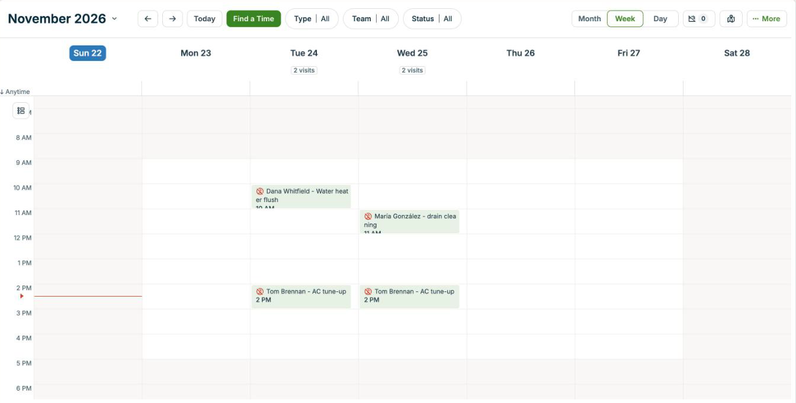

# rezora-jobber-connector

A small prototype that turns a Rezora call transcript into a booked job in **Jobber**. The Rezora FAQ lists Jobber as "coming soon", and this shows what that integration could look like. A call ends, the transcript goes to an LLM that pulls out structured details, and the connector books the visit into an open Jobber slot. Emergencies go to the owner as an urgent request.

```
transcript ──► extract (Groq, JSON mode, pydantic-validated) ──► CallOutcome
                                                                   │
        urgent ──► Jobber Request "URGENT: …" + "owner should call back now"
        no slot ─► Jobber Request
        slot ────► find-or-create Client (by phone) ─► check Visits ─► Job + Visit   (or "conflict" + next free slot)
                                                                   │
                                                              BookingResult
```

## Results (live Jobber test account, API version `2026-11-18`)

Run with `--now 2026-11-23T09:00 --tz America/New_York` (a Monday). `seed.py` put an existing job on Tue Nov 24 at 10:00.

| Transcript | Action | What landed in Jobber | Extract | Booking |
|---|---|---|---|---|
| `ac_tune_up.txt` | `job_booked` | Job "AC tune-up" for Tom Brennan, Wed Nov 25 2:00 PM | 1.1 s | 0.9 s |
| `leak_inspection_conflict.txt` | `conflict` | Nothing booked. Tue 10:00 was taken, next free slot Tue 11:00 AM | 1.4 s | 0.3 s |
| `no_heat.txt` | `urgent_escalated` | Request "URGENT: furnace not working / no heat" with reason in a note, no Job | 1.7 s | 0.9 s |
| `quote_no_time.txt` | `request_created` | Request "heat pump installation" for Karen Liu | 1.3 s | 0.8 s |
| `plomeria_es.txt` (Spanish) | `job_booked` | Job "drain cleaning" for María González, Wed Nov 25 11:00 AM | 1.2 s | 1.0 s |

End to end runs in about 2–3 s per call: roughly 1.3 s for extraction on Groq and 0.3–1.3 s for Jobber, depending on how many mutations the call needs. The conflict case did not double-book; the seeded 10:00 visit is still the only visit in that slot.

One bug turned up in the live run: on the first pass the model resolved "Wednesday" to Tuesday. The prompt now includes an explicit 7-day calendar (`Wednesday = 2026-11-25`, …). The table above shows the run after that fix.



Jobber's Schedule view after the live run. Tue 10:00 is the visit `seed.py` added, which the leak call bumped into. Wed 11:00 (María González, the Spanish call) and Wed 2:00 PM (Tom Brennan) were booked by the connector. The Tue 2:00 PM AC tune-up came from the first run, before the weekday fix.

## Demo UI

```bash
uv run uvicorn rezora_jobber.server:app --port 8000   # open http://localhost:8000
```

The demo page is styled after rezora.io. Pick a sample call, press **Call ended → send to Jobber**, and watch the extracted `CallOutcome`, the `BookingResult`, and the live Jobber schedule for the week. New jobs are highlighted green and taken slots amber.

## Run it locally

1. Create a Jobber Developer Center account and a **developer test account**, then create an app with read/write scopes for clients, requests, jobs and scheduling.
2. Use **Test in GraphiQL** to get an access token (it lasts about an hour).
3. `cp .env.example .env` and fill in `JOBBER_ACCESS_TOKEN`, `GROQ_API_KEY` and `GROQ_MODEL` (we used `openai/gpt-oss-120b`).
4. `uv sync`, then `uv run python seed.py` to add 3 clients and a job on Tue Nov 24 at 10:00.
5. Run a call:

```bash
uv run python cli.py transcripts/no_heat.txt --now 2026-11-23T09:00 --tz America/New_York
```

```bash
uv run pytest            # 9 offline tests, Jobber mocked, no LLM
uv run pytest -m live    # all transcripts end to end against the test account
```

Live runs create real records, so a second `job_booked` run for the same slot comes back as `conflict`. That is the intended behaviour.

## Layout

```
rezora_jobber/
  models.py    CallOutcome, BookingResult
  extract.py   transcript -> CallOutcome (Groq). The only file that knows the LLM; switching to Claude/OpenAI is a one-file change.
  jobber.py    GraphQL client: auth + version headers, errors/userErrors -> JobberError, cost tracking, one backoff retry on THROTTLED
  booking.py   decision logic (pure; takes a JobberClient)
  server.py    POST /calls/completed (the webhook) + demo UI endpoints
cli.py, seed.py, transcripts/, tests/, web/index.html
```

## How this fits into your system

- **Where it plugs in:** on the call-ended event, Rezora sends `POST /calls/completed` with `{transcript, now, timezone}` and gets back a `BookingResult`. If Rezora already extracts call data itself, it can call `booking.book(outcome, jobber_client)` directly and skip the LLM step.
- **Interface:** `CallOutcome` in, `BookingResult` out. The calendar becomes a per-business setting (`calendar_provider = "jobber"`) next to Cal.com, Google and Outlook.
- **What changes on Rezora's side:** a "Connect Jobber" OAuth button in setup step 3 ("Connect your calendar"), and per-business token storage.
- **Mirrors Rezora's product rules:** it never guesses (a missing phone, address or time stays `null`, and a missing phone goes to `needs_human` without touching Jobber), emergencies become an urgent request for the owner instead of a booking, it only books open slots, and Spanish calls produce English fields with `language="es"`.
- **What production still needs:**
  - Full OAuth (authorize URL, token exchange, refresh). This prototype uses a short-lived GraphiQL token.
  - Jobber webhooks, so jobs that are rescheduled or cancelled in Jobber sync back.
  - Mapping each business's Jobber services, line items and pricing.
  - Multi-tech scheduling: assigning the visit to a team member and checking per-tech availability. Right now one booked visit blocks the slot for the whole business.
  - Per-business hours (currently fixed at 8:00–18:00), and structured address parsing (currently the full address goes in `street1`).
  - Idempotency keys on retries, so a re-sent webhook doesn't create a duplicate job.
  - Jobber App Marketplace review.
- **Other field-service tools:** the same `book()` interface would serve ServiceTitan and Housecall Pro behind adapters with the same five methods (`find_client_by_phone`, `create_client`, `visits_between`, `create_job_with_visit`, `create_request`).

## License

MIT
